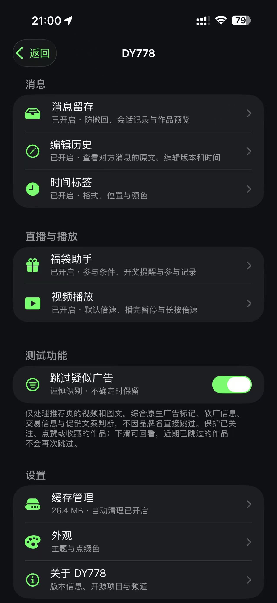

# DY778

iOS 抖音增强插件，提供消息留存、编辑历史、聊天时间标签、福袋助手和播放增强。

当前版本 `1.0-1`，构建目标为 iOS `14.0+`、`arm64`。入口位于 **抖音设置 → DY778**，主要功能首次安装默认关闭，可按需开启。

**仅在抖音 `39.9.0` 测试，其他版本请自行测试。** 如遇闪退或功能失效，欢迎提交 [Issue](https://github.com/jijiang2333/DY778/issues)，并附上抖音版本、iOS 版本、安装方式和复现步骤；有修复或改进方案，也欢迎提交 [Pull Request](https://github.com/jijiang2333/DY778/pulls)。

开源仓库：[https://github.com/jijiang2333/DY778](https://github.com/jijiang2333/DY778) · Telegram 频道：[https://t.me/JiJiang_778](https://t.me/JiJiang_778)。

## 界面预览

深色主题下的插件首页，集中展示消息、直播与播放及常用设置入口。截图中的功能已按需开启。

<p align="center">
  <a href="assets/screenshots/home.jpg">
    
  </a>
</p>

## 功能

### 消息防撤回

- 留存本机已收到的消息，支持按会话单独开关。
- 展示文字、图片、表情、语音、视频和分享卡片中的可用信息，分享作品可跳转原作品。
- 分享评论与对应作品一起展示，保存首次取得的评论文字、作者及可用的评论编号，后续删除提示不会覆盖已留存文字。
- 自定义撤回标记文字、位置和气泡颜色。默认保留气泡皮肤，可开启“撤回后使用普通气泡”；图片、视频和表情画面保持原样。
- 支持撤回提醒、按会话查看，以及删除单条、单个会话或当前账号的全部记录。

### 编辑历史

- 独立开关，支持按会话控制。
- 保存本机收到的原文及后续编辑版本，展示原消息时间、编辑时间和本机留存时间。
- 自定义标记文字、位置及气泡颜色。染色默认关闭，关闭后保留原色；同一消息也已撤回时，已开启的撤回底色优先。
- 可从插件设置、聊天信息页或消息旁的标记进入历史。
- 可选编辑提醒，前台显示横幅，后台实际收到事件时发送本地通知，点按进入对应历史。通知及内容摘要均默认关闭，重复事件不重复提醒。

首次收到时已经编辑的消息会标注未取得原文。启用前、离线或应用未运行期间未收到的版本无法补回。撤回和编辑提醒依赖抖音运行状态及系统通知权限。

### 聊天时间标签

自定义时间格式、字号、颜色、背景、透明度和位置，支持智能日期及隐藏官方时间提示。时间、撤回和编辑标记可分别设置位置，并在空间不足时自动避让。

### 福袋助手

处理当前前台直播间的普通福袋，支持确认后参与或自动参与，显示奖品、倒计时和参与条件。

开启自动评论后可发送指定口令。不自动消费、赠礼、点亮或升级粉丝灯牌；资格不满足或无法确认时跳过。切换直播间、进入后台或关闭开关会取消当前任务。

### 视频播放

- **默认倍速**：可选 `1.25×`、`2×`、`2.5×`、`3×`，支持 `1–3×` 的自定义值，最多两位小数。直播和图文不调整。
- **播放结束暂停**：视频作品播放结束后自动暂停。
- **长按倍速**：支持 `1–3×`，默认 `2×`；长按结束后恢复正常播放速度。

### 缓存管理

查看缓存用量，支持手动清理、容量或时长限制，以及启动清理和返回前台清理。

清理范围包括应用缓存、临时文件、页面资源、投屏缓存和日志，保留识别到的插件配置及消息档案。时长设为「从不」不影响容量限制，容量 `0` 表示不限。缓存用量不等于系统显示的应用总占用。

### 实验功能：跳过疑似广告

默认关闭，仅作用于首页推荐流。根据明确广告标记及多项推广信息判断，已关注、点赞、收藏和自己的作品优先保留；不因单个品牌名、商品标签或价格直接跳过。

不处理搜索、个人主页、聊天分享或直播，跳过的作品仍可返回查看。识别依据为本机可读取的作品字段和标题，可能存在误判或漏判。

## 记录与媒体

撤回记录和编辑历史保存在应用的持久数据目录，与缓存目录分开。保存天数和数量上限默认均为 `0`，不自动过期；手动删除、设置保留限制或清除应用数据仍会删除记录。升级时会迁移旧版设置和档案。

本插件的缓存清理保留上述记录。其他工具若只清理缓存，通常不会影响记录；若直接删除持久数据目录或清空整个应用数据，插件无法阻止或恢复。

媒体文件与文字记录不同：插件不持续下载或永久缓存附件，预览使用抖音现有的本地附件或仍有效的远程地址；视频用原视频预览画面，封面不会作为视频播放。媒体不可读时，可从记录定位原会话中的消息，并短暂高亮整行；原消息也已不在抖音本地记录中时，仍可查看已留存的消息文字与分享评论。抖音媒体缓存被清理、链接失效或作品删除后，媒体可能无法打开。分享评论只保留首次实际取得的文字或语音转写，不能恢复此前没有收到的内容。

## 安装与构建

`DY778-1.0-1-rootless.deb` 用于支持插件注入的 rootless 环境；`DY778.dylib` 可由相应注入工具加载。两者包含相同的动态库，选择一种安装方式，避免重复加载。安装后重新打开抖音。

源码构建需要 Theos 和 iOS 16.5 SDK。在源码根目录执行：

```sh
make package
```

编译目标见 [Makefile](Makefile)，构建时间自动记录为 UTC+8。

也可在 GitHub 的 **Actions → Build DY778 → Run workflow** 中手动构建。完成后从该次运行的 Artifacts 下载 `DY778-rootless`，包含 deb、dylib 和 SHA256 校验文件。工作流仅支持手动触发，推送代码或提交 PR 不会自动构建。

## 致谢

感谢 DYYY 为项目提供的启发。
